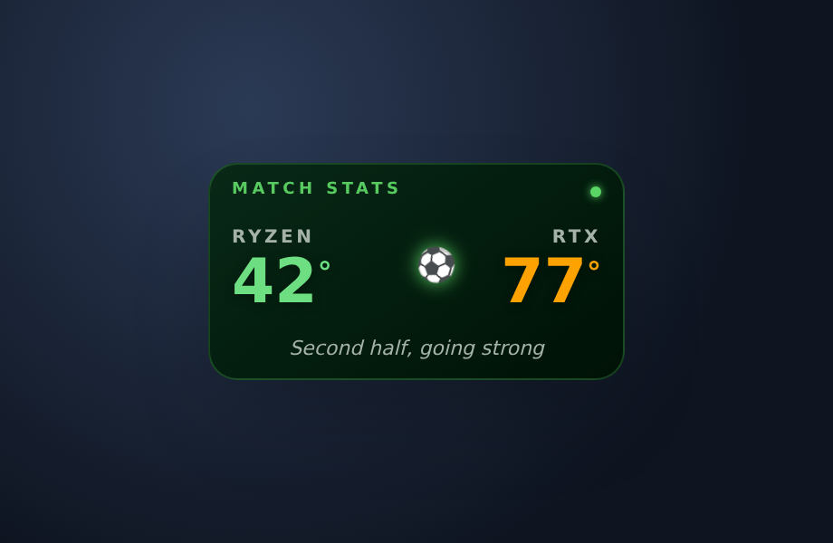

# ⚽ Match Stats

A small, football-themed, always-on-top **CPU/GPU temperature widget** for
Windows 11. It reads live sensor data from
[LibreHardwareMonitor](https://github.com/LibreHardwareMonitor/LibreHardwareMonitor)
and shows it as a match scoreline — **RYZEN vs RTX** — with a bouncing football
whose speed rises with the temperature, live "commentary", per-core sparklines,
and club-kit themes.

Built with **Tauri v2 + React 18 + TypeScript (strict) + Tailwind CSS +
Framer Motion**.



---

## Features

- **Live temps every 2s** from LibreHardwareMonitor's web server
  (`http://localhost:8085/data.json`).
  - CPU: AMD `Tctl/Tdie` (falls back to any CPU temperature sensor)
  - GPU: NVIDIA `GPU Core` + `GPU Hot Spot`
  - NVMe storage temperature
  - CPU / GPU / chassis **fan RPMs**
  - Defensive parser matches sensors by **type + fuzzy node name**, so it
    survives LHM version-to-version naming differences.
- **Football scoreboard UI** — `CPU [45°] ⚽ [52°] GPU`, temp colors
  (green `<60°`, amber `60–80°`, red `>85°`) interpolated smoothly in OKLCH.
- **Animated football** — bounces between the two scores; calm when cool,
  frantic when hot.
- **Live commentary** — _Warming up_ → _Second half, going strong_ →
  _Squeaky bum time_ → _EXTRA TIME — check your fans!_
- **Three sizes**
  - _Single-click_ → **expanded** player-stats panel (per-core temps, GPU
    hotspot, NVMe, fans — each with a 60-sample SVG sparkline).
  - _Double-click_ → **ultra-compact** (just the two numbers).
- **Club themes** — Pitch Green (default), Real Madrid, Barcelona, Man United —
  from the **right-click menu**, persisted to your app config.
- **System tray** — the icon itself shows the current **GPU temperature** as a
  color-coded badge. Tray menu: Show/Hide, Theme, Start with Windows, Quit.
- **Always-on-top, frameless, transparent, drag-anywhere**, remembers its
  screen position, single-instance, optional autostart.
- **"Kick-off pending…"** graceful state (with a tooltip telling you to start
  LHM) whenever the sensor server can't be reached; retries every 5s.

---

## 1. Set up LibreHardwareMonitor (the data source)

1. Download LibreHardwareMonitor and **run it as Administrator** (required to
   read CPU/GPU temperatures).
2. Open **Options** and enable **Remote Web Server** (aka _Run web server_).
   The default port is **8085**.
3. Confirm it works: open <http://localhost:8085/data.json> in a browser — you
   should see a big JSON sensor tree.
4. (Recommended) In **Options**, enable **Start minimized**, **Minimize to
   tray**, and **Run on Windows startup** so the data source is always up.

> If the widget shows **"Kick-off pending…"**, LHM isn't reachable — make sure
> it's running as admin with the web server enabled on port 8085.

## 2. Run the widget (development)

Prerequisites: **Node 18+**, **Rust** (stable), and the
[Tauri v2 prerequisites](https://tauri.app/start/prerequisites/) for Windows
(Microsoft C++ Build Tools + WebView2, which ships with Windows 11).

```bash
npm install
npm run tauri dev
```

The React frontend also runs in a plain browser for UI work
(`npm run dev` → <http://localhost:1420>). Outside of Tauri it automatically
feeds the UI with **evolving mock sensor data**, so you can iterate on the
widget without LHM.

## 3. Get the installer

### Easiest — let GitHub build it (no local Rust toolchain needed)

A GitHub Actions workflow builds the Windows installer on a Windows runner for
you (see [`.github/workflows/match-stats-release.yml`](../.github/workflows/match-stats-release.yml)):

- **Manual:** GitHub → **Actions** → _Build Match Stats installer_ →
  **Run workflow**. When it finishes, download the
  **`match-stats-windows-installers`** artifact — it contains the `.exe` and
  `.msi`.
- **Tagged release:** push a tag and it attaches the installers to a draft
  GitHub Release:
  ```bash
  git tag match-stats-v0.1.0 && git push origin match-stats-v0.1.0
  ```

Then just **double-click `Match Stats_0.1.0_x64-setup.exe`** → it installs
per-user (no admin prompt) and offers to launch on finish. WebView2 is
auto-installed if your machine doesn't already have it.

### Local build (needs Rust + Tauri prerequisites)

```bash
npm run tauri build
```

Artifacts:

```
src-tauri/target/release/bundle/nsis/Match Stats_0.1.0_x64-setup.exe   # recommended installer
src-tauri/target/release/bundle/msi/Match Stats_0.1.0_x64_en-US.msi
src-tauri/target/release/match-stats.exe                               # standalone binary
```

The `.exe` (NSIS) installer is a one-click, per-user install requiring **no
administrator rights**.

---

## Usage / controls

| Action                     | Result                                        |
| -------------------------- | --------------------------------------------- |
| Drag anywhere on the card  | Move the widget (position is remembered)      |
| Single-click               | Toggle the expanded player-stats panel        |
| Double-click               | Toggle ultra-compact mode                     |
| Right-click                | Theme (kit) menu                              |
| Tray icon left-click       | Show the widget                               |
| Tray icon right-click      | Menu: Show/Hide · Theme · Start with Windows · Quit |

---

## Project structure

```
src/
  hooks/
    useSensors.ts      # 2s polling, parsing, 60-sample history, mock fallback
    useConfig.ts       # theme persistence (Tauri store / localStorage)
  lib/
    parseLhm.ts        # defensive LHM sensor-tree parser
    mockData.ts        # LHM-shaped mock generator (drives the same parser)
    temp.ts            # temp → OKLCH color, commentary, ball speed
    window.ts          # widget modes, window resize, drag
  components/
    Scoreboard.tsx     # the football scoreline + animated ball
    ExpandedStats.tsx  # player-stats panel
    StatRow.tsx        # one stat row + sparkline
    Sparkline.tsx      # tiny dependency-free SVG sparkline
    UltraCompact.tsx   # two-number mode
    ContextMenu.tsx    # right-click theme picker
  themes.ts            # pitch-green + club presets (OKLCH)
  types.ts             # shared types (LHM nodes, snapshot, readings)
src-tauri/
  src/lib.rs           # plugins: single-instance, autostart, window-state,
                       #          store, http; tray setup
  src/tray.rs          # dynamic GPU-temp tray badge (hand-rolled pixel font)
  src/themes.rs        # theme ids/names for the tray submenu
  tauri.conf.json      # transparent, frameless, always-on-top window
```

## How the sensor parsing works

LHM serves a nested tree of nodes. The parser
([`src/lib/parseLhm.ts`](src/lib/parseLhm.ts)):

1. Recursively flattens every **leaf sensor**, tagging each with the hardware
   category (`cpu` / `gpu` / `storage`) of its nearest classified ancestor.
   Classification is fuzzy (`ryzen`, `nvidia|geforce|rtx`, `nvme|crucial|…`).
2. Picks the right sensor by **priority regex** — e.g. CPU prefers
   `Tctl/Tdie`, GPU prefers `GPU Core`, hotspot matches `Hot Spot`.
3. Parses `"45.5 °C"` / `"1,234 RPM"` strings into floats (commas as thousands).

Because the mock generator emits the same node shape LHM serves, mock and real
data flow through the exact same code path.
